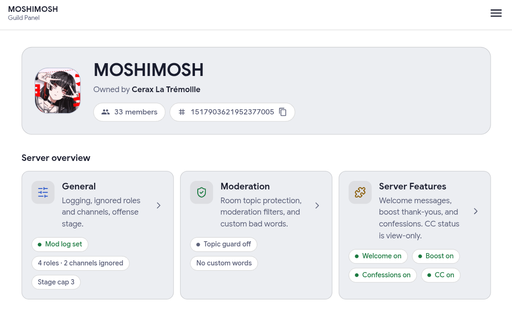
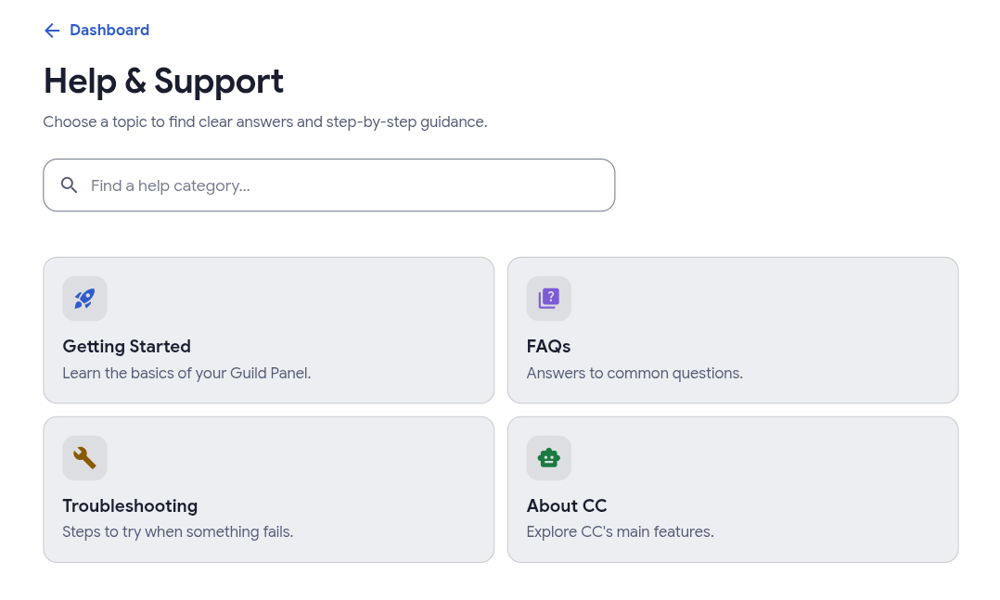

# CC — Community Companion

  
  
  
  

CC is a multi-purpose Discord bot built to make community management and everyday server activities easier.

**Visit CC:** https://sehraks-dc-bot-production.up.railway.app/

> This is the current service address. The bot may move hosting providers in the future, so this link can be updated if the deployment changes.

## What CC offers

- **Moderation tools** — member moderation, timeouts, warnings, offense history, and message cleanup for authorized staff.
- **Server management** — server and member information, role selection, staff-role tools, channel controls, and temporary voice/text room workflows where configured.
- **Community features** — reminders, anonymous confessions, fun/social commands, and personal role menus.
- **CC Companion** — conversational help in supported channels, including AI-backed replies and supported actions.
- **Music and media utilities** — supported music search/download and social-media workflows. Availability may depend on the server's channels, Booster status, and service health.
- **Guild Panel** — a web interface for supported server settings and bot status, with Discord sign-in for eligible server members.
- **Connected services** — optional AI, weather, and other integrations that depend on service availability and configuration.

Features and command permissions may change as CC develops. The command guide is a practical overview, not a guarantee that every command is enabled in every server.

## Getting started

1. Open the [CC home page](https://sehraks-dc-bot-production.up.railway.app/).
2. Follow the available Discord invite or setup instructions there.
3. Add CC to a server only if you have permission to manage that server.
4. Review the [command guide](commands.md) and use Discord's slash-command suggestions for the commands available to you.
5. Grant only the Discord permissions the bot needs for the features you plan to use.

If a feature is unavailable, check the command's permission requirements, any channel/Booster restrictions, and whether its supporting service is online.

## Links

- **CC home:** https://sehraks-dc-bot-production.up.railway.app/
- **Command guide:** [commands.md](commands.md)
- **Implementation repository:** [sehraks/cc-main](https://github.com/sehraks/cc-main)

## Privacy and security

This repository is intended to explain CC's features. It does not distribute the bot's application code or require credentials.

- Never share bot tokens, API keys, OAuth client secrets, session cookies, database credentials, or private environment variables.
- Sign in to the Guild Panel only through the official CC service and Discord's authorization screen.
- Do not grant staff permissions to people who should not be able to moderate your server.
- User content and feature behavior depend on the bot's current implementation and the connected services it uses.

## About this repository

This is a public information and setup guide for CC. It intentionally contains documentation only, not the bot's source code or frontend application files.
